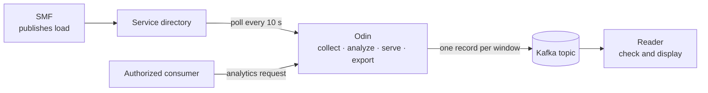

# O2 Labz

O2 Labz is a two-person software engineering team in Regina, Saskatchewan. We are building **Project Odin** with **SaskTel** for the 2026-2027 Software Systems Engineering capstone at the University of Regina.

**Team:** Hashir Owais (project manager and technical lead), Zana Osman (full stack engineer).

---

## Project Odin

Project Odin is a **network analytics function** (NWDAF) that runs inside the 5G core. It reads the load that a network function already publishes, turns that load into statistics, and reports the answer to an authorized consumer.

The build is small on purpose: one SMF, one analytics type (`NF_LOAD`), one window. It is read-only.

### What it does, in order

1. Registers its identity with the service directory, and keeps the registration alive with a heartbeat.
2. Every 10 seconds, reads the SMF's published load through the service proxy.
3. Every 60 seconds, computes the average and the peak load for that window.
4. Writes one JSON record per window to Kafka.
5. Answers an authorized consumer's request for the average, using the standard analytics API.

### What it never does

It never changes another network function. Its only write to the network is its own registration. There is no prediction, no model training, and no event subscription in this build.

SaskTel runs a **multi-vendor 5G cloud**, so nothing in Odin assumes a single vendor.

The build answers one question for SaskTel: should they build their own analytics function or buy one. The proof is a working skeleton on one real use case, with the behaviour and the limits written down.

## How it runs

One replica in the telecom cluster, managed by a Kubernetes operator that watches ConfigMaps. An invalid config edit is rejected as a whole, and the last good configuration keeps serving. A small reader in a separate observability cluster consumes the Kafka records and checks them against their schema.

## Where it stands

SaskTel approved the design for version 1 on 10 November 2026. Nothing is built yet. Development started in November 2026.

## Repositories

| Repo | What it holds | Status |
|---|---|---|
| [`odin-docs`](https://github.com/O2-Labz/odin-docs) | Project management artifacts, solution architecture, SaskTel review material, usability work | Active |
| [`odin-nwdaf`](https://github.com/O2-Labz/odin-nwdaf) | The Go code: the `nwdaf`, `operator`, and `reader` binaries, plus the Kubernetes manifests | Started, scaffold only |
| [`odin-frontend`](https://github.com/O2-Labz/odin-frontend) | Odin Console, the web view that shows an operator what Odin reports | Started, early |

Odin is one code repository on purpose. The operator and the reader share data types with the analytics function, so all three ship together.

## Kanban

All capstone work is tracked on the **Odin Kanban** board: https://github.com/orgs/O2-Labz/projects/4
